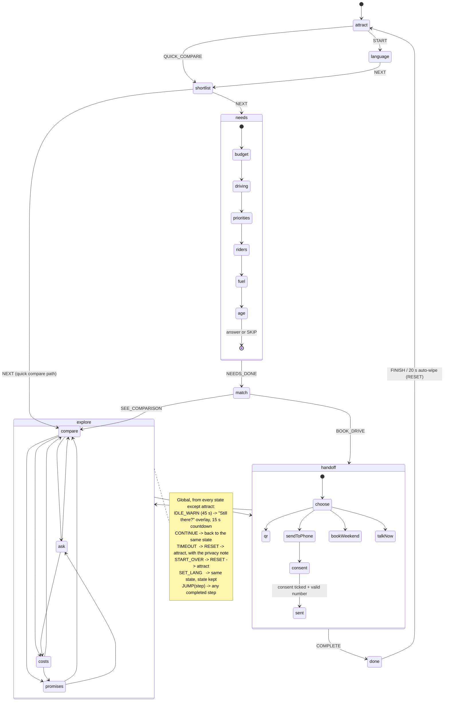

# PLAN: Higher Ground Discovery, kiosk prototype v2

Status: **awaiting approval.** No code has been written. Written 12 Oct 2026.

---

## 1. What gets built

One Vite + React + TypeScript (strict) app, one static deployment, six routes:

| Route | Surface | Rendering |
|---|---|---|
| `/kiosk?channel=nexa\|arena\|pod` | Floor kiosk | `FixedStage` 1080×1920, scaled and letterboxed |
| `/m#<payload>` | Buyer's phone | Responsive 360–430 px |
| `/expert` | Product expert's tablet | `FixedStage` 1180×820 |
| `/council` | SUV Council dashboard | Responsive desktop |
| `/demo` | Judge mode | Desktop; kiosk, phone and tablet embedded as same-origin iframes |
| `/about` | Method, sources, prior art, economics, limits | Responsive page |

`/` redirects to `/demo`.

---

## 2. Architecture

### 2.1 Layers

```
data (JSON, zod-validated at build and on load)
  └─ domain (pure TS, no React): calculators, recommend(), compare(), qa matcher, payload codec, profile guess, council simulator
       └─ state: kiosk reducer (typed state machine) + SessionBus (BroadcastChannel, localStorage fallback)
            └─ UI primitives: FixedStage, Fact, Calc, Sim, ProposedChip, VerifyChip, ImageSlot, SourcesSheet, T (copy)
                 └─ surfaces: kiosk, phone, expert, council, demo, about
```

Everything in `domain/` is a pure function with unit tests. Surfaces never do arithmetic or hold copy.

### 2.2 Kiosk state: typed reducer, not XState

I recommend a typed reducer with an explicit transition table. Reasons:

- The flow is one linear run (attract → match) followed by a free-navigation hub (compare ⇄ ask ⇄ costs ⇄ promises). That is a small graph; XState's hierarchy, actors and invoke are not needed.
- Judge mode has to drive the kiosk from outside (scripted tours, "jump to the moment that proves claim 3"). A reducer whose whole state is one serialisable object makes that a single `HYDRATE` event and makes the session wipe a single `RESET` to a frozen initial state, which is easy to prove in a test.
- The same serialisable state is what goes on the SessionBus and (minus personal data) into the QR payload. One shape, validated by one zod schema.
- It saves roughly 15 KB gzipped against the 300 KB budget.

The cost is that illegal transitions are not prevented by a library, so the transition table is the single source of truth: the reducer rejects any event not listed for the current state, a unit test walks every edge, and the Mermaid diagram below is generated from the table by a script (`scripts/gen-statechart.ts`) so the documentation cannot drift.

Timers (idle 45 s, countdown 15 s, done auto-wipe 20 s) live in one `useIdle` hook outside the reducer and only dispatch events.

### 2.3 State machine



### 2.4 Cross-surface sync

- `SessionBus`: a thin wrapper over `BroadcastChannel('hg-session')`, with a `storage`-event fallback. Messages are zod-validated on receipt.
- The kiosk publishes: `session.started`, `session.updated`, `question.asked`, `handoff.created`, `booking.requested`, `session.wiped`.
- The tablet and council subscribe and keep a small persisted store (localStorage) so a reload does not lose the demo queue.
- Judge mode adds a `control` channel: the tour sends `HYDRATE` and scripted events to the kiosk iframe. Iframes are used deliberately so the sync judges see is the real mechanism, not a shared React tree.
- The phone gets its data **only** from the URL hash. That is what makes the QR work on a real phone with no backend, and it is why the QR path provably carries no personal data.

### 2.5 The "every number is traceable" rule, enforced

Four wrappers, and nothing else may render a digit:

| Wrapper | For | Popover shows |
|---|---|---|
| `<Fact id>` | A value in `facts.json` | Source, URL or doc, date retrieved, status |
| `<Calc id inputs>` | A computed value | Formula, the input facts (each tappable), the user's own inputs |
| `<Sim id>` | Council simulated data | "Simulated", the seed, the assumption |
| `<Ui>` | Pure interface counters: idle countdown, keypad digits, the buyer's own typed inputs, step position | No popover; explicitly allow-listed |

Enforcement:

1. Build fails (zod) if any fact lacks `source`, `url` or `doc`, `retrieved`, `status`.
2. Lint script: no digit characters in JSX text or in `copy.*.json` outside `{fact:…}` / `{calc:…}` slots.
3. Playwright audit on every route and state: walk all text nodes; any digit without a `data-fact`, `data-calc`, `data-sim` or `data-ui` ancestor fails the run.

Programme terms (60%, 3 years, 45,000 km, 48 hours, 24 hours, 90 days, scorecard points, rollout counts, kiosk economics) are facts too, with `kind: "proposal"` or `kind: "team-workbook"`. That flag is what drives the "Proposed: pilot" chip, so a proposal cannot appear unlabelled.

### 2.6 Schema additions to the suggested fact shape

- `doc` as an alternative to `url` (for team research and the brief).
- `kind`: `"published" | "team-research" | "proposal" | "assumption"`.
- `asOf`: the date the figure describes, where it differs from `retrieved` (for example "warranty identical since July 2024").
- `verifiedAbsent: true` for confirmed "Not published" rows, so the UI can distinguish that from `[VERIFY]`.

---

## 3. File tree

```
/
├─ PLAN.md  README.md  CHANGELOG.md  DATA_GAPS.md  SOURCES.md (generated)
├─ IMAGES_NEEDED.md  HINDI_REVIEW.md (generated)  WALKTHROUGH.md
├─ index.html  vite.config.ts  tsconfig.json  vercel.json  package.json (exact pins)
├─ api/
│  └─ ask.ts                      optional live mode, off by default
├─ public/
│  └─ cars/                       drop-in <id>.webp, empty for now
├─ scripts/
│  ├─ validate-data.ts            runs in prebuild; fails the build
│  ├─ gen-sources.ts              facts.json -> SOURCES.md, DATA_GAPS.md section
│  ├─ gen-hindi-review.ts         copy.hi.json -> HINDI_REVIEW.md
│  ├─ gen-statechart.ts           transition table -> Mermaid
│  ├─ lint-numbers.ts             no digits in JSX or copy outside slots
│  └─ contact-sheet.ts            screenshots -> one grid PNG per surface
├─ src/
│  ├─ main.tsx  routes.tsx
│  ├─ data/
│  │  ├─ facts.json  models.json  rivals.json  qa.json
│  │  ├─ copy.en.json  copy.hi.json
│  │  └─ schema.ts                zod for every file
│  ├─ domain/
│  │  ├─ calculators.ts           fuelCostPer1000km, monthlyCost, breakEven, cumulativeCost, evCostPerKm
│  │  ├─ recommend.ts             recommend(answers, channel, catalogue)
│  │  ├─ compare.ts               closest-variant rule, row building, better-value marker, honest read
│  │  ├─ qa.ts                    normalise, Fuse match, context boosts, threshold, guardrails
│  │  ├─ payload.ts               lz-string + zod codec for /m#
│  │  ├─ profile.ts               rule-based profile guess, with its reason
│  │  ├─ conversation.ts          rule-generated three-step suggestion for the expert
│  │  ├─ simulate.ts              seeded pilot data for the council
│  │  └─ format.ts                ₹, lakh/crore, Indian grouping, km/l
│  ├─ state/
│  │  ├─ kioskMachine.ts          states, events, transition table, reducer
│  │  ├─ useIdle.ts
│  │  ├─ sessionBus.ts
│  │  └─ stores.ts                tablet queue, council overlay
│  ├─ ui/
│  │  ├─ FixedStage.tsx  Fact.tsx  Calc.tsx  Sim.tsx  Ui.tsx
│  │  ├─ ProposedChip.tsx  VerifyChip.tsx  SourcesSheet.tsx
│  │  ├─ ImageSlot.tsx  silhouettes/   compact, midsize, off-roader, MPV
│  │  ├─ T.tsx                    copy lookup with slots; throws in dev on a missing key
│  │  ├─ charts/                  hand-rolled SVG: line, funnel, bar; each with a text alternative
│  │  └─ tokens.css  skins.css    one token set, NEXA / Arena / pod skins
│  └─ surfaces/
│     ├─ kiosk/   Attract, Language, Shortlist, Needs, Match, Compare, Ask, Costs,
│     │           Promises, Handoff, Done, IdleOverlay, BottomBar, Progress, Keyboard, Keypad
│     ├─ phone/   expert/   council/   demo/   about/
└─ tests/
   ├─ unit/       calculators, recommend (table-driven), qa, payload, consent gating, machine edges, format
   └─ e2e/        personas ×3, idle wipe, language switch, QR round trip, kiosk→tablet sync,
                  consent gating, number audit, axe, console-clean, screenshots
```

---

## 4. Design decisions that need saying out loud

**Recommendation engine.** Candidates are Maruti Suzuki SUV variants from both channels. Filter by fuel and budget band; score only on the one or two priorities the buyer picked; first pick weighted 60, second 40 (a single pick takes 100); normalise 0–1 across the surviving candidates. Ties break by the launch rule, then lower price. A rival is never the "primary", but when the rival's closest variant beats the pick on the buyer's top priority the result carries `rivalWinsTopPriority`, and the Match screen says so in a plain sentence above the fold, not in a footnote. That is the honest version of "can say a rival suits you better" without the kiosk pretending to sell someone else's car.

**Variant selection rule.** Up to four variants per model: entry petrol manual, mainstream petrol automatic, CNG where currently sold, and the top strong hybrid (or top trim where there is no hybrid), plus the AWD variant where one exists. Stated on `/about`.

**Closest-variant rule.** Same powertrain type where the rival has one, otherwise nearest ex-showroom price. Printed on the Compare screen.

**Honest read.** Template-driven. The rival's winning rows are always sentence one. If the rival wins no row with sourced data on both sides, the template says that the published figures do not separate the two, and does not manufacture a concession.

**Quick compare.** Goes to the shortlist, then straight to Compare using the channel flagship's mainstream variant, with a visible "Answer five questions for a match that fits you" button. Assumption; the brief does not say where quick compare lands.

**Idle in judge mode.** The 45 s idle timer runs normally in free play (it is the proof for claim 6). It is suspended only while a tour is paused, so a judge reading a caption does not lose the tour.

**Typography.** Proposal: the Anek superfamily (Anek Latin + Anek Devanagari, variable, self-hosted via fontsource). One design across both scripts means Hindi and English weights match exactly, and its width axis lets the NEXA skin run a condensed display cut while Arena runs a wider, friendlier one from the same files. Final choice is made in the design pass, with matra clipping checked in screenshots.

**Imagery.** No press photos. SVG body-style silhouettes with the exact shot named, and `IMAGES_NEEDED.md` as the shot list.

**Offline.** `vite-plugin-pwa` precache of the app shell, data and fonts.

**Live AI mode.** Built as specified, off by default, never needed by a judge. Uses `claude-sonnet-5-5` unless you prefer another model; the server-side number check discards any answer containing a figure not in its cited facts.

---

## 5. Facts: what is seeded, what I must research

### 5.1 Seeded from the brief (`status: "from-team-research"`)

All rows of section 11.2, the programme terms, the scorecard lines, the rollout table and the kiosk economics. Each gets `doc: "Team research, Round 2 brief §…"` unless you can give me the underlying file names (question 2 below).

### 5.2 To research before any screen is built

Per variant, for **Fronx, Brezza, Victoris, Grand Vitara, e Vitara, Jimny, Hyryder, Creta, Seltos, Nexon**:

- ex-showroom Delhi price
- powertrain, power, torque, transmission
- claimed efficiency, or range and battery size for the EV
- airbags
- crash rating, with agency and test year
- ADAS level
- boot capacity, ground clearance
- standard warranty

Plus:

- Delhi petrol price from IOCL (the brief's ₹102.12 is flagged; see 5.3)
- Delhi CNG price (IGL)
- a domestic electricity tariff assumption for the EV, stated
- e Vitara energy consumption, if published (otherwise the EV is excluded from cost comparison with a `[VERIFY]` chip)
- hybrid battery warranty, Grand Vitara and Hyryder
- current Maruti Suzuki MPV line-up with seating (Ertiga, XL6, Invicto)
- service network count, current source
- Fronx and Brezza design or special editions on sale now (shown only if verified)

Named verifications from the brief:

- Is the Grand Vitara sold with CNG and with AWD in October 2026?
- Grand Vitara crash-test status under Bharat NCAP
- e Vitara rating agency
- Victoris strong-hybrid top-variant price
- Seltos and Nexon variant prices (the Seltos generation on sale matters here)
- Hyryder strong-hybrid price range, with a source URL
- "1,000+ km per tank" hybrid range claim
- Grand Vitara / Hyryder warranty parity since July 2024

Source order: manufacturer sites, then Bharat NCAP and Global NCAP, then IOCL / IGL, then Autocar India, CarDekho, CarWale, Team-BHP. Conflicts go in `DATA_GAPS.md` and the manufacturer figure is used. Anything I cannot confirm ships as a visible `[VERIFY]` chip.

### 5.3 Two things I have already found in the brief's own numbers

1. **Petrol price.** The brief flags ₹102.12/l itself. Every running-cost figure, the break-even and three unit-test expectations depend on it. I will verify against IOCL first; if it moves, the expected values change and `CHANGELOG.md` records old and new.
2. **A ₹1 rounding difference.** Monthly fuel for the Grand Vitara strong hybrid at 1,500 km is 1,500 ÷ 27.97 × 102.12 = ₹5,476.58, which rounds to **₹5,477**. The brief says ₹5,476, which is what you get by multiplying the already-rounded ₹3,651 by 1.5. Every other check in section 11.2 reproduces exactly (₹3,651, ₹5,769, ₹3,564, ₹2,118, about 43,900 km, about 22 months, ₹6,383–7,659). See question 3.

I also checked the economics: (740 + 3,100) outlets × ₹16,800 = ₹6.45 crore, plus the ₹4 crore content team = ₹10.45 crore. It reconciles, and `/about` will show it as a `<Calc>`.

---

## 6. Build sequence

Each step ends in a commit.

1. **Scaffold.** Vite, React, TS strict, Router, Vitest, Playwright, exact pins, `git init`.
2. **Data layer.** Schemas, seed facts, then research (section 5.2), `facts.json`, `models.json`, `rivals.json`, `DATA_GAPS.md`, generated `SOURCES.md`. Gate: `validate-data` passes.
3. **Domain.** Calculators, format, recommend, compare, payload, QA matcher and `qa.json` (50–80 intents, English and Hindi). Gate: unit tests green, including the section 11.2 checks and the 12+ recommendation cases.
4. **Kiosk, end to end, unstyled.** Machine, `FixedStage`, every state, idle and wipe, Fact/Calc popovers, real QR.
5. **Design pass.** Tokens, two skins plus pod, type, silhouettes, reach-zone layout, Hindi.
6. **Phone**, then **tablet** (SessionBus live), then **council** (seeded simulator plus live overlay), then **judge mode** (iframes, claim chips, three tours), then **/about**.
7. **Hardening.** PWA offline, kiosk lockdown, full-screen, wake-lock.
8. **Verification** per section 19: unit, number audit, e2e at all viewports, screenshots in both skins and both languages (reviewed by eye and fixed), axe, console-clean, Lighthouse.
9. **Independent review** by a fresh subagent with only the brief, the URL and the screenshots. Findings fixed and logged.
10. **Deploy** to Vercel, write `WALKTHROUGH.md`, final report.

---

## 7. Assumptions (say so if any is wrong)

- English copy is mine; Hindi copy is mine and every string is listed in `HINDI_REVIEW.md` for a native speaker. I will not claim it has been reviewed.
- Council data is simulated from a fixed seed and labelled as such on every tile.
- Outlet, expert and phone details are placeholders (`[OUTLET NAME]`, `[EXPERT NAME]`).
- "Send to my phone" sends nothing. The number stays in kiosk memory, is masked on the tablet, and is wiped with the session.
- A booking made on a real phone cannot reach the tablet (no backend). Inside judge mode it does, because the phone is a same-origin iframe. `/about` states this limit.
- Voice input is a stretch goal and will be skipped unless everything else is done.
- Tooling to be installed locally: npm dependencies and Playwright's Chromium (about 150 MB). Neither Playwright browsers nor the Vercel CLI are on this machine yet.

---

## 8. Questions

1. **Vercel.** The CLI is not installed and I cannot sign in for you. When we reach deployment you will need to run `npx vercel login` once. Is there a team or project name you want the URL under? I will ask again before the public deploy itself.
2. **Team research files.** Can you share the workbook, the Round 1 deck and the review-coding sheet (or just their file names and the relevant sheet or slide)? Then every `from-team-research` fact can cite a specific document and location. Without them the popover will read "Team research, Round 2 brief".
3. **₹5,476 or ₹5,477?** I propose computing from unrounded inputs and showing ₹5,477. If the deck already prints ₹5,476, tell me and I will match the deck's method and document it.
4. **Live AI mode.** Build the optional `/api/ask` path now (off by default), or leave it out of v2 entirely?
